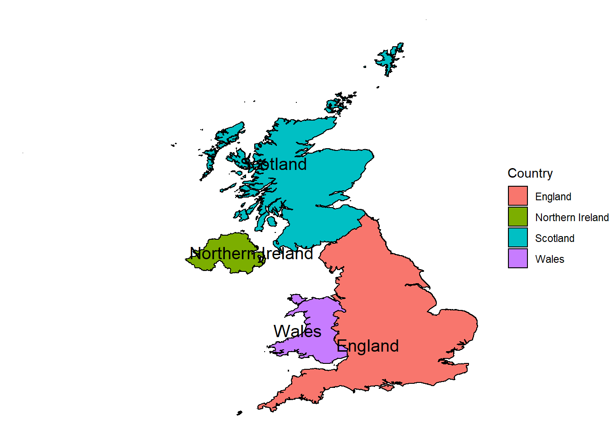

# UK Countries Map

> **Historical portfolio artifact:** this repository preserves the rendered R Markdown report. The standalone source file is not included.

**[▶ View the rendered report](https://raw.githack.com/izzydi/uk-countries-map/main/england_spatial_map.html)**

A map-making exercise in R with `ggplot2`, using GADM 2.8 administrative boundaries for the United Kingdom. The report builds the map step by step: plain outline, country names, borders and a final map of the four countries.

## Repository contents

- [`england_spatial_map.html`](england_spatial_map.html) — rendered report with code and maps.
- [`figures/`](figures/) — map exported unchanged from the report.

## Reproducibility note

The R code is shown inside the rendered report, but the standalone R Markdown file is not in the repository. The report downloads the boundaries from the GADM 2.8 archive.
